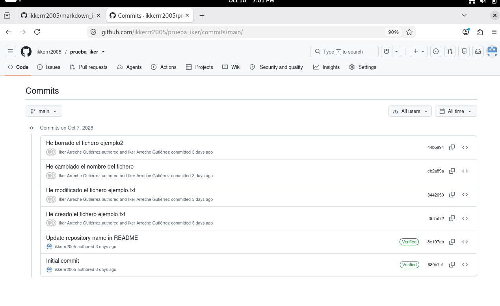

# Mis primeros pasos en 2do ASIR

## Control de versiones con Git y GitHub

En el módulo de **Implantación de Aplicaciones web** hemos empezado aprendiendo a usar *Git*, un sistema de control de versiones. Para subir los cambios al repositorio remoto usamos el comando `git push`.

## Pasos que he seguido

1. Crear una cuenta en GitHub
2.Generar una clave SSH y añadirla a GitHub
3.Clonar el repositorio con la URL SSH
4. Hacer commits y subirlos con `git push`.

##Herramientas utilizadas 
-Debian en VB
-Git
-GitHub
-Firefox

##Ejemplo de comandos

```bash
echo "Esto es una prueba" > ejemplo.txt
git add ejemplo.txt
git commit -m "He creado el fichero ejemplo.txt"
git push 
```
## Comandos principales 

Comando  | Para que sirve | Ejemplo
--------------------------------------
git clone | copia un repositorio remoto | git clone git@github.com
git commit | Guarda cambios | git commit -m "mensaje"
git push | Sube los cambios a GitHub | git push

##Enlaces

-Web oficial de Git: [git-scm.com](https://git-scm.com/)
-Más información: [Detalles del ejercicio](docs/detalles.md)

## Historial de commits de mi primer repositorio



##Mi instituto 

|[Mi instituto](URL_DE_WIKIPEDIA)
